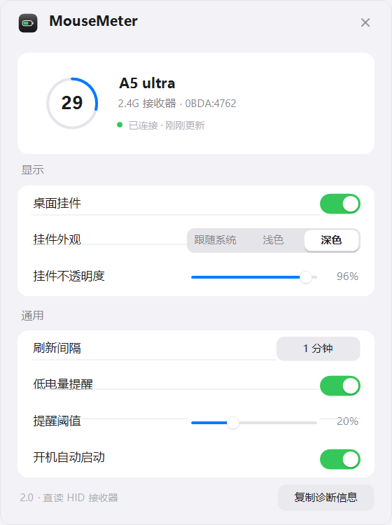

# MouseMeter

Windows 桌面上的外设电量显示器。绕过网页驱动，直接读取 2.4G 接收器的 HID 电量报文，
同时汇总系统电池接口能拿到的蓝牙设备（键盘 / 耳机）。

> **接手开发请先读 [`START-HERE.md`](START-HERE.md)** —— 里面有环境硬约束、代码地图和验证方法。
> 本文件是面向使用者的说明。

| 深色 · 多设备 | 浅色 · 多设备 | 满电 / 低电对比 |
|---|---|---|
|  |  |  |



## 快速开始

**双击 `dist\MouseMeter.exe`** 即可。绿色免安装，无命令行窗口，不需要 PowerShell，不需要管理员权限。

系统要求 Windows 10 1803+ / Windows 11，.NET Framework 4.8 系统自带。单文件 114 KB，零外部依赖。

- **桌面挂件** — 拖动可移动，双击打开设置，右键有菜单
- **托盘图标** — 显示百分比，悬停看详情，右键有菜单
- **开机自启** — 设置里打开，直接注册 exe 路径

`MouseMeter.exe --settings` 可跳过冷启动直接打开设置窗口。

### 改代码时怎么跑

**双击 `dev.cmd`。** 它一次做完三件事：按内容哈希增量编译 → 让旧实例优雅退出（会保存配置）→ 启动新版本。

改一次代码再跑一次，通常 1~2 秒看到界面。源码没改时直接复用缓存，约 0.3 秒。

| 命令 | 用途 |
|---|---|
| `dev.cmd` | 编译变更并重启 |
| `dev.cmd -s` | 同上，并直接打开设置窗口 |
| `dev.cmd -f` | 强制重编（怀疑缓存时用）|
| `dev.cmd -v` | 显示编译耗时与启动参数 |

几个刻意设计的点：

- **先编译、后关旧进程**。编译失败时正在运行的版本不受影响，终端里会直接打印带行号的错误。
- **优雅退出而不是 `taskkill`**。旧实例收到 `--restart` 信号后走正常退出路径，`_cfg.Save()` 会执行，挂件位置和不透明度不会丢。
- **在本进程内加载 DLL**。所以 `OnPaint` 里抛的异常会打在终端上，而不是只剩一个托盘图标消失。

### 出包

```powershell
powershell -ExecutionPolicy Bypass -File .\Build.ps1
```

产物 `dist\MouseMeter.exe`。构建脚本会先用 `IconFactory.WriteIco()` 重画图标，
再把 18 个源文件合并编译成 winexe —— 所以 exe 图标和托盘图标永远一致。
exe 正在运行时覆盖会失败，脚本会提前检测并提示，而不是让 csc 报一句看不懂的 Access denied。

## 功能

| | |
|---|---|
| 读取方式 | 直接与接收器 HID 特征报文通信，不依赖厂商驱动 |
| 多设备 | 鼠标 / 键盘走私有协议，耳机等走系统电池接口（PNP + Bluetooth GATT），挂件按设备分行显示 |
| 刷新 | 默认 60 秒，可设 15 秒 ~ 15 分钟；鼠标休眠时不会额外唤醒消耗 |
| 低电量提醒 | 自定义阈值（默认 20%），到点弹通知，图标转琥珀/红 |
| 充电状态 | 绿色图标 + 挂件显示闪电与「充电中」 |
| 外观 | 挂件支持跟随系统 / 浅色 / 深色，不透明度与缩放可调 |
| 休眠处理 | 保留最后读数并淡显，不会突然变成「未检测到」 |

## 文件结构

```
MouseMeter/
├─ START-HERE.md         接手开发入口（环境约束 / 代码地图 / 验证方法）
├─ Build.ps1             出包脚本：重画图标 → 合并源码 → 编译 dist\MouseMeter.exe
├─ MouseMeter.ps1        开发用启动器：检查源码哈希 → 编译或复用缓存 → 启动
├─ Compiler.ps1          多文件合并 + CodeDOM 编译 + DLL 缓存
├─ run-hidden.vbs        PowerShell 方案的静默入口（仅从源码运行时有用）
├─ settings.sample.json  配置样例
├─ dist/                 可分发产物：MouseMeter.exe + 使用说明
├─ src/
│  ├─ AssemblyInfo.cs    程序集版本与元数据（资源管理器「详细信息」里显示）
│  ├─ Hid.cs             Win32 HID 枚举与特征报文读写
│  ├─ Protocol.cs        迈从 / Realtek 报文编解码（请求构造、应答校验、型号字段）
│  ├─ VendorHidSource.cs 私有协议读取通道（遍历接收器、重试预算、PID 回显校验）
│  ├─ PnpBattery.cs      从 PnP / 注册表拿蓝牙设备的电池百分比
│  ├─ SystemBatterySource.cs 系统电池接口聚合（耳机等无私有协议设备）
│  ├─ DeviceHeuristics.cs 设备分类（名称 / HID usage / 音频端点推断）
│  ├─ DeviceManager.cs   多来源合并、排序、主设备选取、休眠判定
│  ├─ Settings.cs        配置读写（手写 mini JSON，零依赖）
│  ├─ Theme.cs           色板、字体、圆角绘制、DWM 窗口特效
│  ├─ Material.cs        材质选择（毛玻璃 / 回退链 / tint 换算）纯逻辑，可测
│  ├─ IconFactory.cs     托盘图标与 app 图标绘制（多分辨率 ico）
│  ├─ RowPainter.cs      挂件与托盘共用的电量行绘制（字号自适应、进度条、徽标）
│  ├─ Controls.cs        自绘控件：开关、滑块、分段控件、按钮
│  ├─ MenuRenderer.cs    右键菜单渲染（圆角、勾选、分隔线）
│  ├─ HudForm.cs         桌面挂件
│  ├─ SettingsForm.cs    设置窗口
│  └─ Program.cs         托盘、轮询、单实例、生命周期
├─ tests/
│  ├─ TestRunner.cs      <!-- AUTO:assertions -->88 项<!-- /AUTO -->协议 / 分类 / 合并 / 材质 / 打包断言（零依赖）
│  └─ PreviewRenderer.cs 离线渲染挂件与设置窗口，调用的是生产绘制代码
├─ tools/
│  └─ check-syntax.ps1   非 Windows 环境下的编译闸门（LangVersion 5 + 可跑测试）
├─ docs/
│  ├─ CONTEXT.md         背景、决策记录、踩坑史
│  ├─ PROTOCOL.md        HID 协议逆向（逐字节报文表）
│  ├─ ARCHITECTURE.md    架构、类职责、线程模型
│  ├─ DESIGN.md          视觉规范（颜色 / 字体 / 尺寸 token）
│  ├─ ROADMAP.md         12 项优化任务 + 验收标准
│  └─ screenshots/       真实渲染截图
└─ MouseMeter.ico        自动生成的应用图标
```

运行数据在 `%APPDATA%\MouseMeter\settings.json`，编译缓存在 `%LOCALAPPDATA%\MouseMeter\cache`，崩溃日志在 `%LOCALAPPDATA%\MouseMeter\error.log`。

## 支持新设备

数据来源是可插拔的。每个来源实现一个接口，返回「这次读到的所有设备」：

```csharp
public interface IBatterySource
{
    string Name { get; }        // 设置窗口「设备识别」里显示的名字
    List<Reading> Read();       // 绝不能抛异常；没设备时要快速返回空
}
```

`Reading` 里最关键的是 `Id`（跨轮次稳定，用于合并与休眠判定）、`Kind`（mouse / keyboard /
headset）、`Level`（-1 表示未知）、`Charging`、`Transport`。

新增品牌只需两步：

1. 写一个 `IBatterySource` 实现，把报文格式、report ID、字段偏移锁在自己的类里；
2. 在 `DeviceManager` 构造函数里加一行 `_sources.Add(new YourSource());`。

`DeviceManager` 按注册顺序把各来源的结果合并去重，同一设备以「有读数的来源」为准，
然后排序（主设备是鼠标）。接收器的 VID:PID 白名单在 `settings.json` 的 `receiverIds` 里，
也可以把新设备的 ID 直接加进去——`VendorHidSource` 自带发现模式：找不到白名单匹配时，
会扫描所有 `feature report ≥ 65 字节` 的 vendor collection 并尝试同一套报文。

已知的迈从报文（A5 Ultra 4K 接收器，`0BDA:4762`，collection `0xFF01/0x0001`）：

```
写入 65 字节  [0]=0x12  [1]=0xF9(0x06^0xFF)  其余 0xFF
读取 65 字节  [0]=0x11  回包 [1]==0xF9 有效
payload 逐字节取反： [11]=电量  [12]=充电中  [10]==0x09 表示走接收器
```

排查问题时用设置窗口右下角的**复制诊断信息**，里面含接收器 ID、轮询成功率和最后读数。

## 已知限制

- 私有协议只覆盖 2.4G 接收器路径。鼠标切到蓝牙模式后走的是另一套 GATT 电池服务，
  由系统电池接口兜底——能出百分比，但拿不到「充电中」和休眠细分。
- 品牌支持取决于能否摸清该型号的 HID 报文，不是所有接收器都愿意回答查询。
- 首次运行时 Windows 可能把托盘图标折叠进「隐藏的图标」，点任务栏的 `^` 展开、把它拖到常显区即可。
- 需要先关掉厂商的网页驱动——它会独占接收器的 HID 通道。

## 卸载

设置里关掉开机自启 → 托盘右键退出 → 删除本目录。注册表项在 `HKCU\Software\Microsoft\Windows\CurrentVersion\Run\MouseMeter`。
